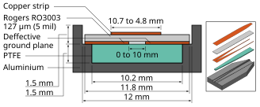

Grounding is a very important point in modern electronics. The often recommended way to do this is to use a ground plane just below the lines referenced to it. However, the important point is for the ground to follow the signals, and the plane geometry is just a convenience for this. Here is a review of interesting variants.

## A review of interesting geometries

## 1. The bunch of coaxial shields

The typical lab bench comprises several metallic boxes connected by coaxial cables. Coaxial cables are used a minima for RF and signals. Serious setups use them also for supplies. In such a setup, the grounding between the boxes is made by the boxes themselves and by the coaxial cables.

## 1.1 Nuvotronics coax

In the wide scale of the labs, coaxial cables are often used. On the contrary, using modern 3D manufacturing techniques, this techique is also possible on a micro scale. Sure it is very expensive, but definitely working well.

*Copyright Cubic Nuvotronics, https://www.cubic.com/sites/default/files/2024-05/2023%20Nuvo%20Product%20brochure_R32_PRINT.pdf*

## 1.2 The bunch of cables with their ground wire

Oh the other hand of the robustness, when connecting various boxes but without shielded cables, accompanying each bunch of connectors by one or several ground wires connected to the grounds on each side is almost always better than the reverse.

This configuration can be seen as a *very crude* approximation of coaxial lines, however improved when several ground wires are used and tightly coupled to their corresponding signal wires, ideally in a one to one fashion.

## 2. Differential lines

In the *bunch of ground wires* approach, I deliberately did not mention the various differential pairs approach, who are probably the *very most* common approach in consumer electronics: DDR signals, PCIe, Ethernet, USB, and so on.

Roughly speaking, in single-ended lines, you have a big connector, whose potential won't change a lot precisely because it is big, and a small connector using the big conductor as a potential reference. Let put aside for now questions like the meaning of the potential, how to deal with the multiple definitions of the potential, and to what this potential should be refered to. Just say for now they are important questions for later.

On the contrary, in differential lines, you have a + connector and a - conductor, typically connected to two signal sources with symmetric impedances. Here the question of where is the ground becomes really interesting.

Imagine for whatever reason that instead of a differential line *two* single-ended lines are used, in a +, GND, GND, - fashion. Since the 2 GND conductors are at the same potential (there are more complicated was to tell this), connecting them don't change the picture (let aside a few details). Eventually they can be merged into a single unique conductor. But since in this conductor, not current flows (let aside a few details), it can even be removed.

This illustrates that between the conductors of each differential pair there is a surface, behaving like a ground. When the conductors are straight, this surface is a plane, called a symmetry plane, and often modelled in EM simulators as a perfect conducting plane. When the conductors are not straight, for instance in twisted pairs, the shape of this surface is much more convoluted, but you still have a virtual grounding effect.

## 3. Grids

More often than not, grids are useful for grounding, even if their limitations must be taken into account: they stop working well when the frequency is too high compared to the size of the holes, and it is difficult to have a controlled impedance line with such a ground.

One typical use is shielded boxes with holes for air cooling.

Some decades ago, in 2 layers TTL or CMOS digital boards, a strategy was to route ground and power in grid fashion, and the spacing between the ground lines was used to route signal traces. Note that in this particular case, both ground and supply behave as ground, due to the decoupling capacitors connecting them. Also such circuits did not need controlled impedance lines.

Finally, grids are also convenient for the grounding of a whole room containing shelves of devices.

## 4. Coplanar

Ground does not need to be below the line. A perfectly working configuration is to have the ground on both sides of the lines. However, is is very important to ensure both grounds are connected together.

A typical very high frequency PCB configuration is to have a mixture between coplan and microstrip called grounded coplanar microstrip where grounds are both on the sides and below, regularly connected through vias.

On PCBs, the typical dimensions lead to a microstrip dominant operation, and the side grounds mainly improve shielding. However, on some MMICs, the dimensions lead to a coplanar dominant operation.

## 5. Weirder shapes

In more complex case, the ground can have a non regular shape, either to achieve a particular effect, or just a convenience.

A first example is this schme I used a few years before to achieve the impedances I wanted while keeping the trace widths I wanted. The ground plane with the ground and the metalic part on which it is attached behave as a single ground conductor.

<figure>
  <picture>
    <source
      srcset="/posts/coax-combiner-low-Z-isolation/preadaptation-2D-3D-v3-web-dark.svg"
      media="(prefers-color-scheme: dark)">
    
  </picture>
  <figcaption>Fig.&#8239;7. Section of the impedance prematch structure (not to scale) and 3D view.</figcaption>
</figure>

A second example are hybrid modules. Here, inputs and outputs have coaxial shapes, ground is all around all sections of the circuits, and a ground plane is provided everywhere.

*Copyright SemiGen, https://www.semigen.net/about/*

## A derivation of rules

### Connections inside PCB

#### Horizontal PCB connections

It can be safely assumed that the optimal grounding scheme for systems where frequency high enough dominate (> 1 MHz), that ies most of the systems, would be to have coaxial cables between each functional block. Even if this scheme is totally unpacticable at the board level, it can be approximated by following a few rules.

It can be shown mathematically that a coxial line is equivalent to a microstrip line with an infinite ground plane and all other signal being on the other side of the ground plane. This might seem inconvenient at a first glance, but note that it is a common practice to put on different sides of ground planes signals which would be very likely to perturbate each other.

A good approximation is to have microstrip lines with ground plane extending at least 5 times the substrate thicknes (or 3 times if relaxed) around the line, and to have nearby line no closer than the same amount. Once again, common PCB design rules.

#### Vertical PCB connections

The careful reader would have noticed that the previous rules solved the case of horizontal propagation in the PCB, but not the case of layer to layer propagation. Hence the base "coax rules" provides again answers: the ideal coxial line between the layers turns to be simple stitching vias, for simple case, or a full coaxial circle of vias for very high (> 10 GHz) frequencies.

### PCB to outside connections

#### Coaxial connectors

A straightforward application of the coaxial ideal is the use of RF coaxial connectors or BNC connectors typically used for the low frequency signals (also by tradition, BNC connectors works work without any problem beyond 1 GHz), either directly screw-mounted to the chassis or connected through an intermediate coaxial cable to it.

#### Low frequency signals (e.g. banana plugs)

Lower frequency wires, not always using coaxial connectors, when then are referrenced to a ground, should always be accompagnied by a ground wire connected on both sides. Not doing this creates typically large loops, either large current loops producing radiation, or large loops receiving radiation.

The case of isolated wires, typically the red and black connector of an isolated power supply, won't be covered here, but a viable strategy could be to treat them as two coupled signals with a common ground conductor grounded on both sides.

## Conclusion

Most good practices of grounding and shielding signals can be derived from approximations of the coaxial cables everywhere scheme.
